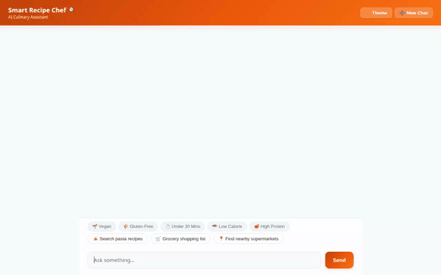

# Smart Recipe Chef 🍳

Smart Recipe Chef is an AI-powered culinary assistant built with Google's **Agent Development Kit (ADK)** and deployed on **Vertex AI Agent Engine**. It helps users search for recipes, manage ingredient shopping lists, remember dietary restrictions across sessions, discover local supermarkets, generate high-resolution dish images, and generate cooking videos.



---

## Implemented Features & Architecture

Based on the codebase in `app/` and `agents-cli-manifest.yaml`, Smart Recipe Chef implements the following core tools and Google Cloud integrations:

### 🧠 Cross-Session Memory & Personalization
* **Vertex AI Memory Bank**: Persists user dietary restrictions, food allergies, and preferences across chat sessions using `PreloadMemoryTool` and `VertexAiMemoryBankService`.

### 📚 Recipe Management & Database Lookups
* **Google Cloud Firestore Database**:
  * `search_recipes`: Queries the `recipes` Firestore collection by cuisine, ingredient, or recipe name.
  * `get_recipe_details`: Fetches full ingredient breakdown and step-by-step cooking instructions.
  * `save_recipe`: Stores user-submitted custom recipes in the `custom_recipes` Firestore collection.
* **Online Recipe API Integration**:
  * `search_online_recipes_api`: Fetches external web recipe results via Spoonacular API.

### 🛒 Shopping Lists & Supermarket Discovery
* **Grocery List Generation**:
  * `generate_shopping_list`: Computes and formats grocery shopping checklists for selected recipes.
* **Google Maps & Places API**:
  * `geocode_address` & `find_nearby_places`: Finds nearby supermarkets and grocery stores based on address or location.

### 🎨 Multimodal Media Generation
* **Google Imagen Image Generation**:
  * `generate_dish_image`: Generates high-resolution dish images via `genai.Client(vertexai=True, location="global")`, uploads them to Google Cloud Storage (`qwiklabs-gcp-01-899d7fa5a36d-static-assets-bucket`), and renders public HTTPS image cards.
* **Google Gemini Omni Video Generation**:
  * `generate_dish_video`: Generates short cooking process videos using `gemini-omni-flash-preview` in the `global` region, saves them as session artifacts, and uploads them to Google Cloud Storage.

### 🎨 UI & Frontend Protocol
* **A2UI Protocol (Agent-to-User-Interface)**: Formats structured UI cards, images, and rows via `a2ui_callback`.
* **Custom Chat Frontend**: Responsive web UI featuring quick dietary filter chips, an animated cooking loader, dark mode toggle, interactive grocery checklists, and session reset capability.
* **Code Execution Sandbox**: Secure Python execution environment via `AgentEngineSandboxCodeExecutor`.

---

## Planned / Not Yet Implemented Features

* 📱 **Native Mobile App (iOS / Android)**: Planned for future iterations; current implementation is web-based.
* 🎙️ **Voice-Guided Cooking Mode**: Hands-free voice prompts and speech-to-text navigation are planned for upcoming releases.

---

## Local Development & Setup

### Prerequisites
* Python 3.11+
* Node.js v18+
* Google Cloud SDK with authenticated `gcloud` credentials

### Running Locally

1. **Install Dependencies**:
   ```bash
   pip install -r requirements.txt
   cd frontend && npm install && cd ..
   ```

2. **Configure Environment Variables**:
   ```bash
   export AGENT_ENGINE_RESOURCE_NAME="<your-reasoning-engine-resource-name>"
   export AGENT_DIRECTORY="app"
   ```

3. **Start the Frontend Server**:
   ```bash
   python frontend/main.py
   ```
   Access the local web interface in your browser at `localhost:8080`.

### Recording a Demo Video

To record a new screen-capture demo video with the branded frame:
```bash
NODE_PATH=./node_modules node .agents/skills/record-demo/record-agent.js \
  -q "Search for easy Italian pasta recipes" \
  -q "Generate a realistic dish image of a freshly cooked bowl of creamy Spaghetti Carbonara" \
  -o agent_demo.webm
```
